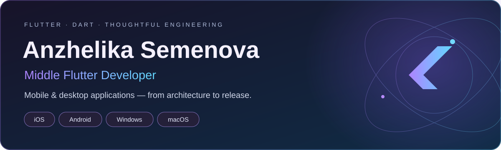
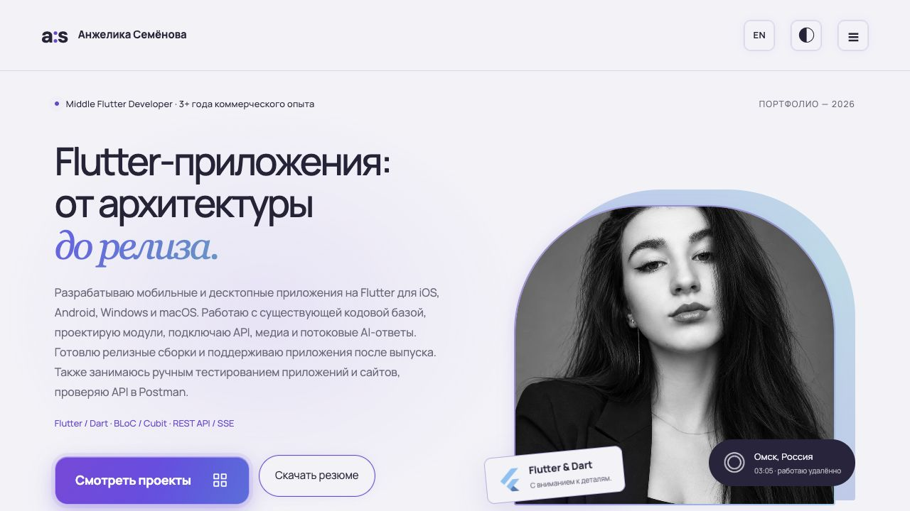

# Сайт-портфолио · Анжелика Семёнова

**[Открыть сайт — portfolio.semenova-anzhelika.online](https://portfolio.semenova-anzhelika.online/)**

Личное портфолио Middle Flutter Developer: коммерческие продукты, инженерные кейсы, собственные проекты, опыт, навыки и контакты.



## Что есть на сайте

- Русская и английская версии, светлая и тёмная темы.
- Коммерческие проекты Alpina Plus, AlpinaGPT и EvolverAI с описанием моего вклада.
- Личные проекты Questopia, Fitoria и DPS Tracker с галереями интерфейсов.
- Семь инженерных кейсов: архитектура, прогресс, SSE, медиа, ссылки и менторинг.
- Отдельные разделы навыков, опыта, сертификатов и рекомендации.
- Резюме на двух языках и форма подготовки письма через почтовое приложение.
- Плавные переходы, анимации прокрутки, фиолетово-голубые акценты и Flutter-птичка вместо курсора на подходящих устройствах.
- Навигация по разделам с активным пунктом и обновлением якоря при прокрутке.

## Технологии

HTML · CSS · JavaScript · GitHub Pages. Статический сайт без обязательной установки пакетов.

| Файл | Назначение |
| :--- | :--- |
| `index.html` | Содержание, разделы и модальные окна |
| `app.js` | Переводы, проекты, кейсы и взаимодействия |
| `scroll.js` | Анимации прокрутки и навигация по разделам |
| `motion.js` | Дополнительные эффекты и курсор |
| `contact.js` | Подготовка и копирование письма |
| `assets/` | Фотографии, галереи, резюме и сертификаты |
| `CNAME` | Пользовательский домен GitHub Pages |

## Локальный просмотр

```bash
git clone https://github.com/Liker4ik26/portfolio.git
cd portfolio
python3 -m http.server 8000
```

Откройте `http://localhost:8000`. Для проверки синтаксиса при наличии Node.js: `node --check app.js` и `node --check scroll.js`.

## Публикация

GitHub Pages использует корень ветки `main`. Домен: `portfolio.semenova-anzhelika.online`. Изменение файлов в `main` обновляет опубликованный сайт; файл `CNAME` сохраняет привязку домена.

## English overview

A bilingual portfolio for Anzhelika Semenova, Middle Flutter Developer. Commercial work, personal projects, engineering cases, skills, experience, certificates, résumé downloads and contact details. Built with HTML, CSS and JavaScript; hosted on GitHub Pages with a custom domain.

---

**Автор — Анжелика Семёнова · [Liker4ik26](https://github.com/Liker4ik26)**

[Сайт](https://portfolio.semenova-anzhelika.online/) · [Telegram](https://t.me/Liker4ik50) · [Почта](mailto:pr110oat18@gmail.com)
